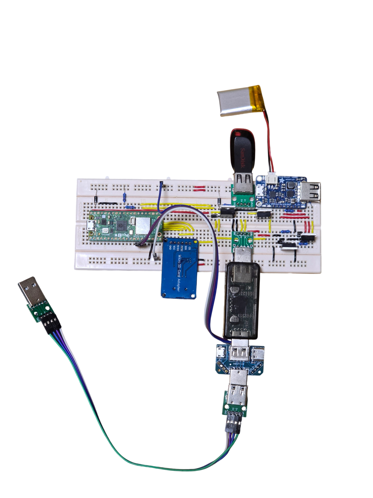
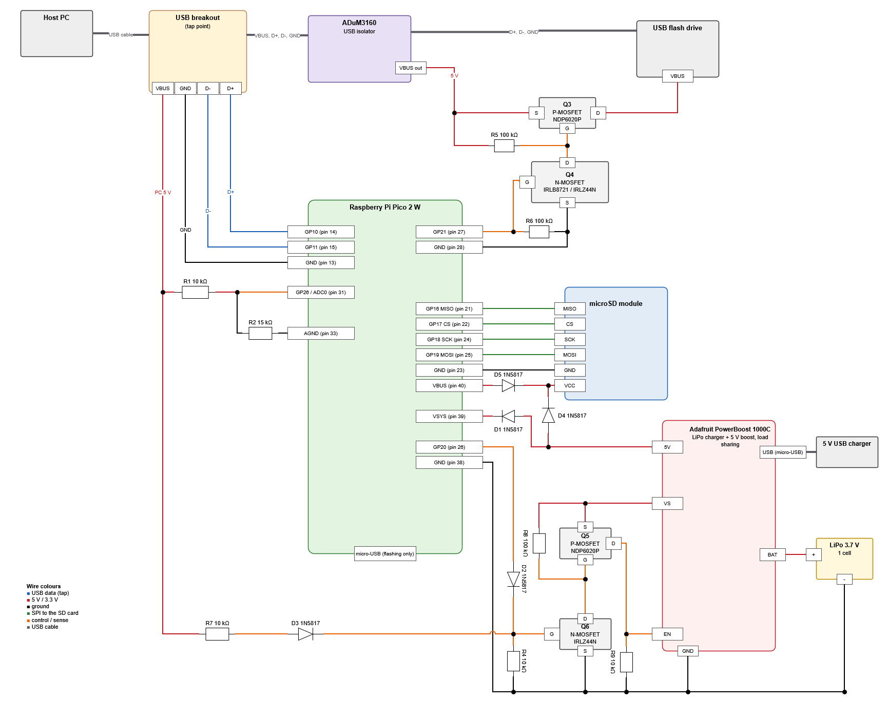

# USB Audit Tap

A passive USB tap on a Raspberry Pi Pico 2 W. It sits on the cable between a PC and a USB flash drive, listens to the data lines, and keeps a tamper-evident log of what the PC did to the drive: every sector read and written, the drive being plugged in and out, and (for exFAT drives) the files created, renamed, edited, moved and deleted.

The log goes to an SD card inside the tap. It is hash-chained and encrypted, and the tap checks the whole card at every start-up. If the check fails, the drive gets no power.

This is a proof of concept. It handles USB 1.1 (Full Speed, 12 Mbit/s) only.

## What it does

- Samples D+ and D- with the RP2350's PIO at 48 MHz and decodes USB in software. The tap never drives the bus, never answers a packet and never changes traffic.
- Pairs each mass storage command with its status and logs it: READ/WRITE with sector range, plus eject, flush, format and the rest.
- Logs bus events: drive attached, detached, reset.
- Rebuilds exFAT file names from the directory sectors on the bus and logs file changes with full paths. The raw directory sectors are kept on the card too, so every name can be checked again later.
- Seals every record with HMAC-SHA256 over the previous record, so changing, removing or reordering anything breaks the chain. Sessions are chained to each other across the whole card.
- Encrypts the card with ChaCha20.
- Keeps a checkpoint of the card's last record in the Pico's own flash, so a log cut short, an older copy of the card or a different card is refused.
- Powers the drive through a MOSFET switch only after the start-up check passes (fail-closed).
- Runs on a battery after the PC is unplugged, closes the session cleanly, then turns itself off.

## What it doesn't do

- No High Speed. This is a hardware limit: the RP2350's pins can't read High Speed signals, so a proof of concept on this chip stops at Full Speed. An ADuM3160 isolator in the cable keeps the drive at Full Speed.
- No file contents. File data is skipped on purpose; only commands and directory sectors are kept.
- No real-time clock. Times in the log are counted from each start-up.
- File names only for exFAT drives. FAT32 drives still get commands and bus events.

## Hardware





## Building

You need the Pico SDK 2.3.1 with its toolchain (the Raspberry Pi Pico VS Code extension installs both) and Python 3.

The firmware has two secrets built into it. Make them once:

```
python tools/make_secret.py log-key
python tools/make_secret.py card-password
```

The first writes `secrets/log_key.txt` and prints the key. **Back it up.** Without it no log can be read or verified. The second prints a random card password once and stores only its hash. Use `--ask` to choose your own. To keep `secrets/` elsewhere, add `--dir <folder>` to both commands and build with `cmake -B build -G Ninja -DSECRETS_DIR=<folder>`.

Then build:

```
cmake -B build -G Ninja
cmake --build build
```

Hold BOOTSEL while plugging in the Pico and copy `build/USBLogger.uf2` to the drive that appears. The tap has no USB serial port, so it can only be reflashed this way.

## Using it

1. Format an SD card (FAT32 or exFAT) and put a file called `card_password.txt` in its root, holding the card password.
2. Put the card in the tap and plug the tap into the PC. The tap reads the password, wipes and deletes the file, accepts the card and restarts.
3. When the LED is on, the drive is powered and everything is logged.
4. To end a session, unplug the tap from the PC. The tap closes the log on battery and turns off. The next session starts when it is plugged back in.

| LED | Meaning |
|---|---|
| slow blink | checking the card |
| on | ready, drive powered |
| fast blink | card refused (failed check, wrong or full card, no card), drive kept off |
| off | session closed |

## Reading the log

```
python tools/read_log.py
```

Pick `AUDIT.BIN` copied off the card (keep any `AUDIT001.BIN`, `AUDIT002.BIN`, ... next to it), paste the log key and press Verify. It checks every block and every chain, then lists the sessions with what happened in each one, per file, and what it knows about the drive. If anything was altered it says which session.

Installing the `cryptography` package makes it much faster on a big card. It works without it.

The tap checks the whole card at every start-up, about 0.9 ms per block of log, so a long log slows the start. After a check the reader shows the card's state. When it says the card needs a clean-up, press its **Clean up card** button: it backs the log up, clears the card and writes a new `card_password.txt`.

## Known limits

- Creating or deleting dozens of files in a few seconds fills the bus with directory sectors faster than the Pico 2 can decode them. This is a hardware limit and the SD card's SPI link is too slow to hold the overflow for later. Around 5 to 35 of 300 directory writes are affected. Each one is logged as a warning and every command is still logged, but some file names in that burst may be missing.
